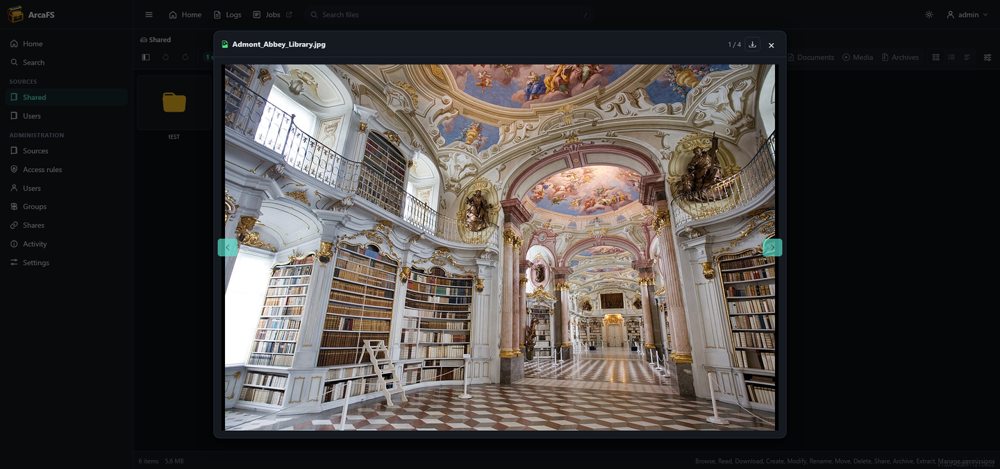

Arca File System. A self-hosted file browser built with .NET 10 / Blazor.

Permissions are **per user, per path, on each source**. That means you can give each person a writable home folder and keep a shared folder read-only for everyone except you — something a source-wide read-only switch cannot express.

## Screenshots





## Features

- Multi-source file browsing (tiles, list, compact, gallery)
- Upload, download, copy, move, rename, delete, compress, extract
- Indexed search, thumbnails, text editor, media preview
- Public share links (password, expiry, download limits)
- Path-based ACL with templates for common family/team layouts
- Theme picker (26 Bootswatch themes)
- Hangfire job dashboard and LogVue log dashboard
- ASP.NET Identity (default), Keycloak, or no-auth desktop mode
- SQL Server, PostgreSQL, MySQL, or SQLite

## Run locally

```powershell
dotnet restore
dotnet run --project ArcaFS
```

Open http://localhost:5000 (or the URL printed by `dotnet run`). With the default SQLite + Identity settings, the first-run wizard creates the administrator and the first source.

## Configuration

Set these in `ArcaFS/appsettings.json` or as environment variables (`Database__Provider`, …):

| Key | Values |
|-----|--------|
| `Database:Provider` | `Sqlite` (default), `SqlServer`, `Npgsql`, `MySql` |
| `ConnectionStrings:DefaultConnection` | Provider-specific connection string |
| `Authentication:Provider` | `Identity` (default), `Keycloak`, `None` |
| `Seed:Admin:Email` / `Seed:Admin:Password` | Optional seed administrator (Identity) |

## Docker

```powershell
docker compose up -d
```

The default stack is PostgreSQL + ASP.NET Identity at http://localhost:8080. Copy `.env.example` to `.env` to change passwords. Mount extra folders and add them as sources under **Administration → Sources**.

To use Keycloak, set `Authentication__Provider=Keycloak`, fill in `Authentication__Keycloak__*`, and uncomment the `keycloak` service in `docker-compose.yml`.

## Desktop (Electron)

The desktop build forces **SQLite + no authentication** and opens the signed-in user's profile folder as the first source. Data lives under `%LocalApplicationData%\ArcaFS`.

```powershell
dotnet run --project ArcaFS.Desktop
```

Build a Windows installer from the repo root (requires the .NET 10 SDK and Node.js 22+):

```powershell
.\create-installer-win.ps1
```

The NSIS installer is written to `ArcaFS.Desktop\publish\Release\net10.0\win-x64\`. Packaging is a self-contained `dotnet publish` (profile `win-x64`); ElectronNET.Core then runs electron-builder. The older `electronize` CLI is not used.

## Permissions

Open **Administration → Access rules**. Templates:

- **Per-user home directories** — each signed-in user owns `/${username}`
- **Shared, read-only except for me** — everyone can browse and download; one nominated user can write
- **Drop box** — upload-only submissions folder
- **Group workspace** — one group collaborates in a folder
- **Administrators only** — deny by default

Rules can also be opened from a folder via **Access rules** in the context menu.

## EF migrations

Generate provider-specific migrations after model changes (set nothing in appsettings — each data project has a design-time factory):

```powershell
dotnet ef migrations add InitialCreate -p ArcaFS.Data.Sqlite -s ArcaFS -c ArcaFS.Data.Sqlite.ApplicationDbContext --output-dir Migrations
dotnet ef migrations add InitialCreate -p ArcaFS.Data.Sql    -s ArcaFS -c ArcaFS.Data.Sql.ApplicationDbContext    --output-dir Migrations
dotnet ef migrations add InitialCreate -p ArcaFS.Data.Npgsql -s ArcaFS -c ArcaFS.Data.Npgsql.ApplicationDbContext --output-dir Migrations
dotnet ef migrations add InitialCreate -p ArcaFS.Data.MySql  -s ArcaFS -c ArcaFS.Data.MySql.ApplicationDbContext  --output-dir Migrations
```

## Roadmap

- Make reverse-proxy trust configurable (`X-Forwarded-*`). The app currently accepts those headers from any peer so Synology / Docker proxies work; that should be an opt-in (or limited to private networks) so a directly exposed Kestrel instance cannot have its client IP or scheme spoofed.

## Support

If you find this project useful, consider supporting its development.

<p align="center">
  <a href="https://buymeacoffee.com/vnmatt">
    
  </a>&nbsp;&nbsp;&nbsp;
  <a href="https://www.paypal.com/cgi-bin/webscr?cmd=_donations&business=gordon_matt%40live%2ecom&lc=AU&currency_code=AUD&bn=PP%2dDonationsBF%3abtn_donateCC_LG%2egif%3aNonHosted">
    
  </a>
</p>

<p align="center">
  Prefer using your phone? Scan the QR code:
</p>

<p align="center">
  <a href="https://buymeacoffee.com/vnmatt">
    
  </a>
</p>


