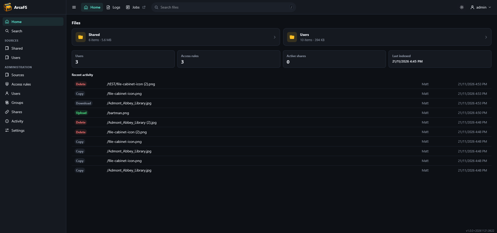
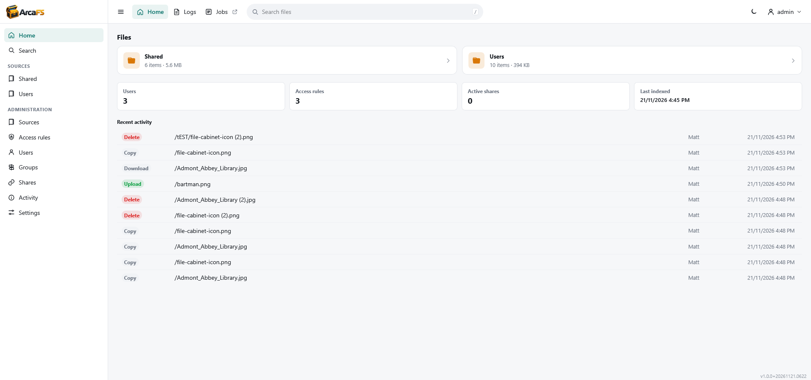
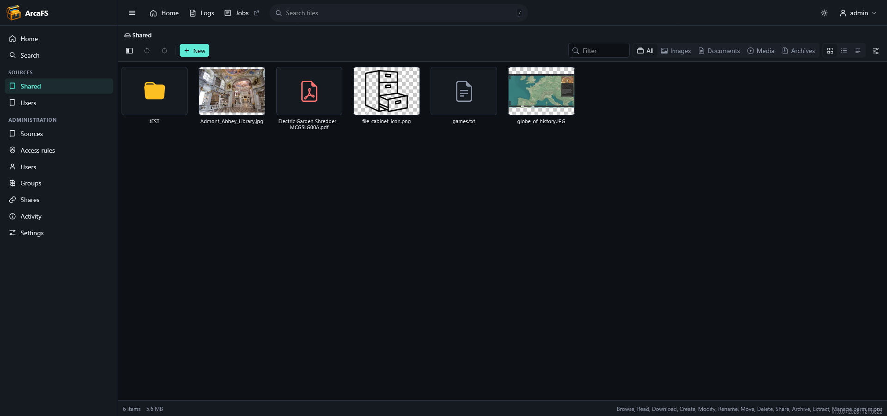
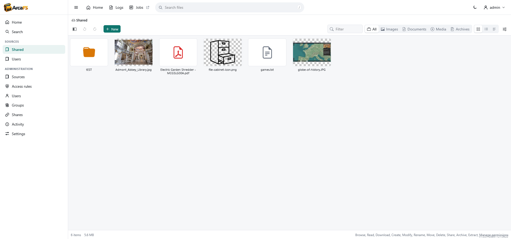
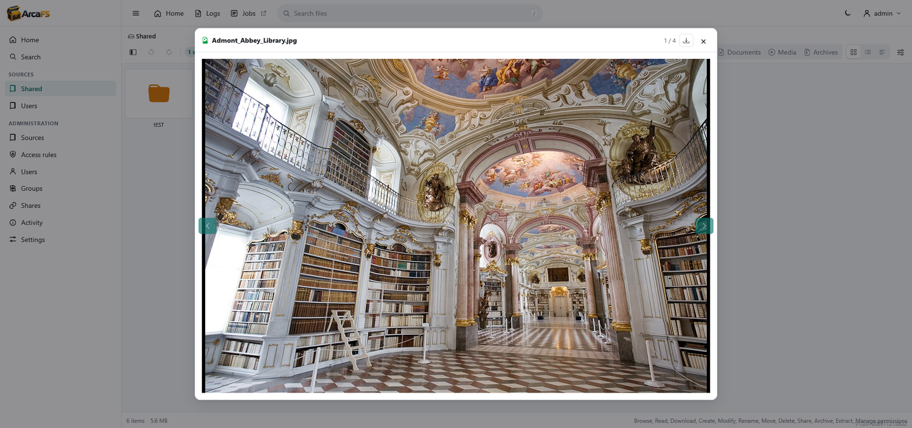

Arca File System. A self-hosted file server built with .NET 10 and Blazor Server.

A source is a folder on the host. Permissions are **per user, per path, on each source**, so one person can have a writable home folder while everyone else has a shared folder they can only read. A source-wide read-only switch cannot express that.

## Screenshots












## Features

### Browsing

- Home lists the sources you can reach, with indexed item counts. Administrators also see user, rule, and share counts plus recent activity.
- The sidebar lists sources and your favourites. A read-only source is marked as such.
- The file browser has breadcrumbs, a folder tree (hidden until you turn it on), tiles, list, and compact views, and kind filters for images, documents, media, archives, and folders.
- Sort by name, size, modified date, or kind. Hidden files stay out of the listing until you opt in. Symlinks are not followed unless the source says so.
- Select with the mouse or keyboard, including select all and invert selection. A details panel shows the current item.
- Top-bar search jumps to the search page. The browser also filters the open folder by name.

### File operations

- Upload files or a folder, download a file, or download a selection as a zip. The request body limit defaults to 4 GB.
- Create folders and text files. Copy, cut, paste, rename, duplicate, move, and delete. Paste from a folder's context menu goes into that folder.
- Drag an item onto a folder to move it. Hold Ctrl (or Command) to copy instead.
- When a name is already taken, each file can be replaced, kept under a new name, or skipped, and the choice can apply to the rest of the batch. That covers upload, paste, move, and extract.
- Compress a selection to zip, tar, or tar.gz. Extract asks about conflicting top-level names and refuses archives that would escape the destination folder.
- Undo and redo cover create, rename, move, copy, and text saves, for this browser session, up to 50 steps. Delete asks for confirmation and is not undone. Undo will not remove a folder or file that has gained contents since it was created.
- Text saves refuse to overwrite a file that changed after you opened it.

### Search and indexing

- Sources are indexed in the background (every 60 minutes by default). Search runs against that index and can be limited to one source.
- The query language supports `type:image` (and video, audio, document, archive, text, code, pdf, folder), `largerThan` / `smallerThan`, `newerThan` / `olderThan`, quoted phrases, `case:exact`, and `draft|final`.
- Each source can set exclude globs and can be left out of the index.

### Previews, editor, and thumbnails

- Images, video, audio, and PDFs open in a dialog over the folder, or on their own page. That choice is an instance setting.
- Text and code open in an editor, up to 5 MB.
- Image thumbnails are cached as WebP. Video thumbnails use a frame from the middle of the file when ffmpeg and ffprobe are available. The official ffmpeg build is GPL, so ArcaFS will not download it unless `Thumbnails:Video:DownloadIfMissing` is turned on. Without ffmpeg, videos keep their icon.
- Oversized image uploads can be shrunk to a maximum width and height. That is off by default (`Uploads:ImageResize`).

### Sharing

- A public link can point at a file or a folder. It can be read-only, upload, or read-write, and it never grants more than the person who created it can do.
- Optional password, expiry, and download limit. A share can hide thumbnails or the in-browser viewer.
- You manage your own links under **My shares**. Administrators see every link. Public pages live at `/s/{token}`.

### Permissions

Open **Administration → Access rules**, or **Access rules** on a folder. Templates:

- **Per-user home directories** — each signed-in user owns `/${username}`
- **Shared, read-only except for me** — everyone can browse and download; one nominated user can write
- **Drop box** — upload-only submissions folder
- **Group workspace** — one group collaborates in a folder
- **Administrators only** — deny by default

Rules name a user, a group, the owner, or anyone signed in, and they can allow or deny individual permissions: browse, read, download, create, modify, rename, move, delete, share, archive, extract, and manage permissions. A source can deny by default, start from a baseline such as read-only, and optionally let administrators skip the rules.

A source can also confine each user to a starting folder, with `${username}` or `${userid}` in the path, and can create that folder on first visit.

### Administration

- **Sources** — name, host path, description, read-only, indexing, hidden files, symlink policy, and sidebar visibility. The folder picker stays inside `Hosting:DataRoot` when that directory exists.
- **Users** and **groups** when ASP.NET Identity is the provider. Keycloak users are managed in Keycloak.
- **Activity** records uploads, downloads, copies, deletes, shares, sign-ins, denied permissions, and index scans.
- **Settings** — site name, default light/dark/system scheme, where files open, whether public shares are allowed, and whether people can register themselves.
- Hangfire job dashboard at `/hangfire` and the LogVue log dashboard at `/logvue`. Log entries older than 30 days are deleted.

### Look and deployment

- Light, dark, or match the operating system. The choice is stored in the browser. Accent colour is teal.
- PostgreSQL, SQLite, SQL Server, or MySQL, each with its own EF Core migrations. Hangfire can use the same database or `ConnectionStrings:Hangfire`.
- ASP.NET Identity, Keycloak, or no authentication. No-auth is what the desktop build uses.
- Docker Compose and an Electron desktop build (experimental only for now).

## Run locally

```powershell
dotnet run --project ArcaFS --launch-profile http
```

Open http://localhost:5090. The `https` profile also listens on https://localhost:7182.

`appsettings.json` leaves `Seed:Admin:Password` empty, so the first visit opens the setup wizard at `/setup`. That wizard creates the administrator and the first source. `appsettings.Development.json` supplies a seed administrator, so a Development run skips the account step and only asks for the source.

## Configuration

Set these in `ArcaFS/appsettings.json` or as environment variables (`Database__Provider`, and so on):

| Key | Values |
|-----|--------|
| `Database:Provider` | `Sqlite` (default), `SqlServer`, `Npgsql`, `MySql` |
| `ConnectionStrings:DefaultConnection` | Provider-specific connection string |
| `ConnectionStrings:Hangfire` | Optional. Empty uses the application database |
| `Authentication:Provider` | `Identity` (default), `Keycloak`, `None` |
| `Authentication:Keycloak:*` | Authority, client id, secret, and optional public origin / backchannel URL |
| `Seed:Admin:Email` / `UserName` / `Password` | Optional seed administrator. Empty password leaves account creation to the wizard |
| `Hosting:DataRoot` | When this directory exists, the folder picker cannot leave it. Docker sets `/app/data` |
| `Thumbnails:Enabled` | `true` by default |
| `Thumbnails:Video:Enabled` | `true` by default. Needs ffmpeg and ffprobe |
| `Thumbnails:Video:DownloadIfMissing` | `false`. Set `true` only if you accept the GPL ffmpeg build |
| `Uploads:MaxRequestBodyMegabytes` | `4096` |
| `Uploads:ImageResize:Enabled` | `false`. `MaxWidth` and `MaxHeight` default to 2560 |
| `LogVue:RetentionDays` | `30`. `0` keeps every log entry |

## Docker

```powershell
docker compose up -d
```

The default stack is PostgreSQL 18 and ASP.NET Identity at http://localhost:8080. Postgres is published on host port 5434. Copy `.env.example` to `.env` to change the database password and the seeded administrator password.

The app container mounts `./data/files`, `./data/logs`, and `./data/thumbnails` under `/app/data`. `Hosting:DataRoot` is `/app/data`, so sources you add from the wizard have to live under that tree. Mount extra folders there, then add them under **Administration → Sources**.

The image does not install ffmpeg. Video thumbnails stay off until ffmpeg and ffprobe are on the container `PATH`, or until you set `Thumbnails__Video__DownloadIfMissing=true`.

To use Keycloak, set `Authentication__Provider=Keycloak`, fill in `Authentication__Keycloak__*`, and uncomment the `keycloak` service in `docker-compose.yml`.

## Desktop (Electron)

The desktop build forces **SQLite** and **no authentication**, skips the setup wizard, and opens the signed-in user's profile folder as the first source. The database, Hangfire store, thumbnails, and logs live under `%LocalApplicationData%\ArcaFS`.

```powershell
dotnet run --project ArcaFS.Desktop
```

Build a Windows installer from the repo root (requires the .NET 10 SDK and Node.js 22+):

```powershell
.\create-installer-win.ps1
```

The NSIS installer is written to `ArcaFS.Desktop\publish\Release\net10.0\win-x64\`. Packaging is a self-contained `dotnet publish` (profile `win-x64`); ElectronNET.Core then runs electron-builder. The older `electronize` CLI is not used.

## EF migrations

Generate provider-specific migrations after model changes. Leave `appsettings.json` alone — each data project has a design-time factory:

```powershell
dotnet ef migrations add InitialCreate -p ArcaFS.Data.Sqlite -s ArcaFS -c ArcaFS.Data.Sqlite.ApplicationDbContext --output-dir Migrations
dotnet ef migrations add InitialCreate -p ArcaFS.Data.Sql    -s ArcaFS -c ArcaFS.Data.Sql.ApplicationDbContext    --output-dir Migrations
dotnet ef migrations add InitialCreate -p ArcaFS.Data.Npgsql -s ArcaFS -c ArcaFS.Data.Npgsql.ApplicationDbContext --output-dir Migrations
dotnet ef migrations add InitialCreate -p ArcaFS.Data.MySql  -s ArcaFS -c ArcaFS.Data.MySql.ApplicationDbContext  --output-dir Migrations
```

## Roadmap

- Make reverse-proxy trust configurable (`X-Forwarded-*`). The app currently accepts those headers from any peer so Synology / Docker proxies work; that should be an opt-in (or limited to private networks) so a directly exposed Kestrel instance cannot have its client IP or scheme spoofed.

## Support

If you find this project useful, consider supporting its development.

<p align="center">
  <a href="https://buymeacoffee.com/vnmatt">
    
  </a>&nbsp;&nbsp;&nbsp;
  <a href="https://www.paypal.com/cgi-bin/webscr?cmd=_donations&business=gordon_matt%40live%2ecom&lc=AU&currency_code=AUD&bn=PP%2dDonationsBF%3abtn_donateCC_LG%2egif%3aNonHosted">
    
  </a>
</p>

<p align="center">
  Prefer using your phone? Scan the QR code:
</p>

<p align="center">
  <a href="https://buymeacoffee.com/vnmatt">
    
  </a>
</p>


